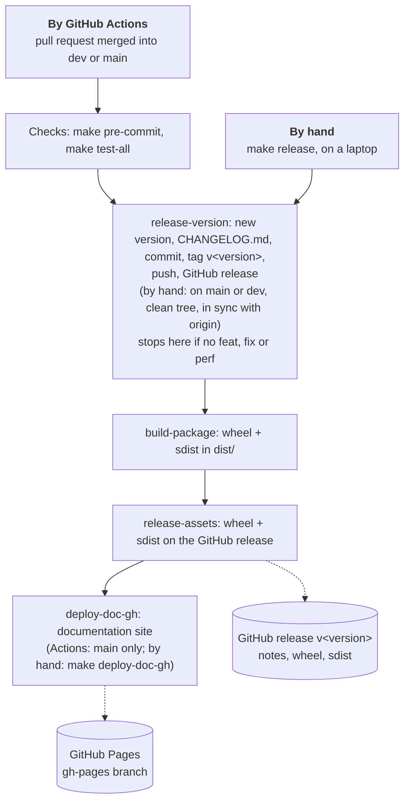
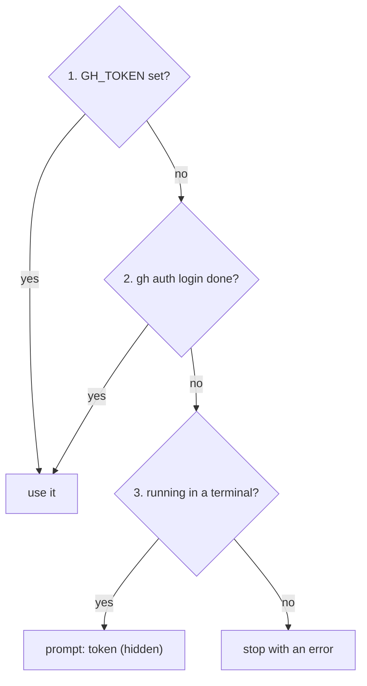

# 5. Release

Publish a version: by hand from a laptop, or by GitHub Actions after a merge. Both run the same
`make` targets, so both give the same release.

## Overview



## What a release publishes

| What                                                      | Where                            | By hand                             | By GitHub Actions                                     |
|-----------------------------------------------------------|----------------------------------|-------------------------------------|-------------------------------------------------------|
| version, `CHANGELOG.md`, tag `v<version>`, GitHub release | this repository                  | `make release-version`              | after a merge to `main` (stable) or `dev` (`-rc.<n>`) |
| wheel + sdist on the GitHub release                       | this repository                  | `make build-package release-assets` | `main` and `dev`                                      |
| documentation site                                        | GitHub Pages (`gh-pages` branch) | `make deploy-doc-gh`                | `main`, when a version was released                   |

The version comes from the commit messages since the last tag ([3. Conventions](3.conventions.md#commit-convention)): no
`feat`/`fix`/`perf`, no release.

| Branch | Commits                                                     | Version                       | Result                |
|--------|-------------------------------------------------------------|-------------------------------|-----------------------|
| `dev`  | `feat`, `fix`, `perf`                                       | `v1.1.0-rc.1` → `v1.1.0-rc.2` | GitHub prerelease     |
| `dev`  | `feat!` / `BREAKING CHANGE`                                 | `v2.0.0-rc.1`                 | GitHub prerelease     |
| `main` | `feat`, `fix`, `perf`                                       | `v1.1.0`                      | GitHub release + docs |
| `main` | `feat!` / `BREAKING CHANGE`                                 | `v2.0.0`                      | GitHub release + docs |
| any    | `docs`, `chore`, `ci`, `style`, `refactor`, `build`, `test` | —                             | nothing               |

## By hand

```bash
git checkout main && git pull   # or dev for a release candidate
make release                    # release-version, then build-package and release-assets
make deploy-doc-gh              # the documentation site, after a release on main
```

`make release` stops after `release-version` when there is nothing to release.
`make deploy-doc-gh` builds the site and pushes it to the `gh-pages` branch; it is not part of
`make release`.

### Guards

`make release-version` refuses to run, and changes nothing, when:

| Check                                              | Message                                              |
|----------------------------------------------------|------------------------------------------------------|
| the branch is not `main` or `dev`                  | `Release from main or dev only`                      |
| there are uncommitted changes                      | `Uncommitted changes: commit or stash first`         |
| the branch differs from `origin` after `git fetch` | `<branch> is not in sync with origin/<branch>`       |
| no GitHub token can be found                       | `No GitHub token: set GH_TOKEN or run gh auth login` |
| no releasable commit, or the tag already exists    | `No releasable commit since the last tag` (exits 0)  |

The release commit is authored with your git identity (the bot's in CI: `GIT_COMMIT_AUTHOR`).
The git hooks are disabled for that one commit only, so pre-commit does not reformat
`CHANGELOG.md`.

### Credentials

A target looks for a GitHub token in this order and uses the first it finds:

| Order | Method                               | Setup                         |
|-------|--------------------------------------|-------------------------------|
| 1     | `GH_TOKEN` in the shell or in `.env` | a token with the `repo` scope |
| 2     | the `gh` login                       | once: `gh auth login`         |
| 3     | hidden prompt                        | nothing; on a terminal only   |



`make release-assets` calls `gh` directly: it uses `GH_TOKEN` or the `gh` login, never a prompt.
In GitHub Actions the automatic `GITHUB_TOKEN` is passed as `GH_TOKEN`, so step 1 always applies.

## By GitHub Actions

| Workflow                                 | Trigger        | Does                                                                                  |
|------------------------------------------|----------------|---------------------------------------------------------------------------------------|
| `🔶 Release — Dev` (`dev-release.yml`)   | push to `dev`  | checks, then `make release-version build-package release-assets`: a GitHub prerelease |
| `🚀 Release — Main` (`main-release.yml`) | push to `main` | checks, then the same targets: a GitHub release, then `make deploy-doc-gh`            |

A merged pull request is a push, so each merge runs the workflow once. The release commit carries
`[skip ci]`, so it never triggers another release.

### Repository settings (once)

- Settings → Actions → General → Workflow permissions: "Read and write permissions".
- Pages: "Deploy from a branch: `gh-pages`". The branch is created by the first
  `make deploy-doc-gh` (by hand or by the first `main` release). If GitHub refuses to deploy from
  the branch, see [this discussion](https://github.com/orgs/community/discussions/39054).

## After a release: sync main into dev

```bash
git checkout dev && git pull
git merge main      # merge commit, direct push (no pull request)
git push
```

Expect conflicts on `CHANGELOG.md` and `project.version` in `pyproject.toml`: semantic-release
changed both on both branches. Keep `main`'s (stable wins over the release candidate), then
`git merge --continue`. The next release candidate on `dev` then starts from the stable version.
